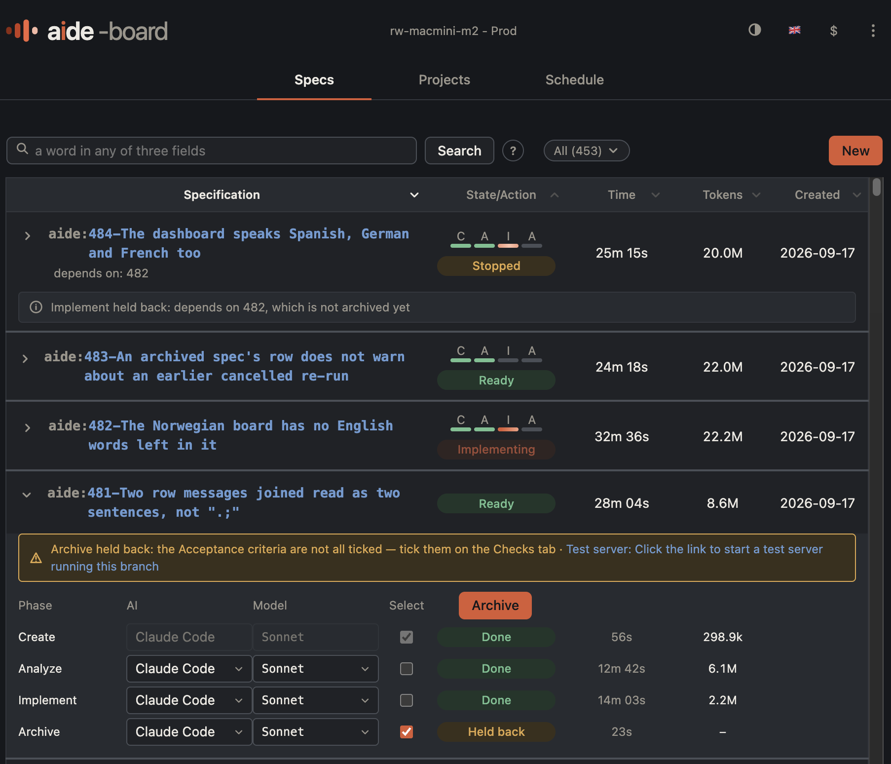

# <picture><source media="(prefers-color-scheme: dark)" srcset="docs/assets/aide-wordmark-dark.svg"></picture>

## Table of contents

- [What Aide is](#what-aide-is)
- [What a spec looks like](#what-a-spec-looks-like)
- [Install](#install)
- [A first run](#a-first-run)
    - [From a terminal or an AI session](#from-a-terminal-or-an-ai-session)
- [The skills in your AI CLI](#the-skills-in-your-ai-cli)
- [Where Aide sits in spec-driven development](#where-aide-sits-in-spec-driven-development)
- [Read on](#read-on)

---

Spec-driven development with AI CLIs: every change starts as a spec, and a board runs it through analysis,
implementation and archiving on Claude Code, Codex or OpenCode.

## What Aide is

Before an AI CLI writes code, the change is written down as a spec: plain-Markdown files that say what is wrong
(you write that), what the codebase looks like around it and the plan (the AI CLI writes those), and what each step
did. The spec is committed to git, in the project or in
a specs repository of its own, so the reasoning a chat history loses is still there to review a month later.

The **board** (the dashboard) is a local web application that runs the specs. You add a project, write a spec, and
press Run: it takes the spec through analyze, implement and archive, each step a real run of the AI CLI and model you
chose for it, in a worktree of its own. It runs several specs at a time, records each step's cost and outcome, holds
the spec before archive until you have ticked its acceptance criteria, and merges the code only once the project's
own tests pass on the merged result.

The steps run only on the board. You start them from its buttons, or with the `aide` command from a terminal or an
AI session. Aide also installs a few skills into each AI CLI, for the work around a spec.

Aide is a personal tool: one user, one machine, no sign-in, and every run uses that user's own AI accounts. Nothing
has to be committed to a project for Aide to work on it, so it works on a repository someone else owns.

<!--suppress HtmlDeprecatedAttribute, CheckImageSize -->
<p align="center"></p>

<!--suppress HtmlDeprecatedAttribute -->
<p align="center"><em>The specs list: the phase each spec has reached, what is running now, and the controls that
start the next phase.</em></p>

---

## What a spec looks like

A spec is a folder of five files:

- `0-README.md` — a table of contents linking the other four
- `1-description.md` — what is wrong and what done means, with the acceptance criteria. You write it
- `2-analysis.md` — what analyze found in the codebase, with file and line references
- `3-solution.md` — the plan analyze writes for implement to follow
- `4-status.md` — what each step did, and the acceptance criteria as rows only you tick

From an archived spec of Aide's own, shortened where it says `[...]`:

```markdown
## Problem

When a spec's archive is held back on unticked acceptance criteria, its row on the specs list adds "Test server:
click the link to start a test server running this branch". [...] The spec page already checks that before it shows
the start button; the row does not.

## Acceptance criteria

- **AC-1:** For a spec held back on unticked acceptance criteria, belonging to a project whose checkout carries the
  dashboard's source, the row SHALL show the held-back mark together with a link to start a test server.
- **AC-2:** [...] belonging to a project whose checkout does NOT carry the dashboard's source, the row SHALL show the
  held-back mark alone, with no test-server link.
```

How to write the description and its criteria is in
[A spec's lifecycle](dashboard/docs/spec-lifecycle.md#writing-a-spec).

---

## Install

Aide runs on macOS and Linux; on Windows, inside [WSL](https://learn.microsoft.com/en-us/windows/wsl/install). Install
these first — Aide checks for them and installs none of them:

```bash
curl https://mise.run | sh              # mise, then follow its own instructions for your shell
mise use -g node@lts                    # a node, which the tools Aide declares are installed with
curl -fsSL https://claude.ai/install.sh | bash   # an AI CLI, here Claude Code
```

Then clone Aide and run its installer. It installs Aide's skills, rules and commands for all four AI CLIs in your
home directory, nothing into your projects, and the tools its scripts call through
[mise](https://mise.jdx.dev). It names the command for anything it needs and cannot find.

```bash
git clone https://github.com/ragnarwestad/aide.git
cd aide && ./install-all.sh
```

Open a new terminal afterwards, since the installer adds a line to your shell's `PATH`, and sign in to your AI CLI
once (`claude`, then `/exit`). To install for one AI CLI only, run its own installer:

| AI CLI         | Install                                       | Documentation                                             |
| -------------- | --------------------------------------------- | --------------------------------------------------------- |
| Claude Code    | `core/implementations/claude-code/install.sh` | [INSTALL.md](core/implementations/claude-code/INSTALL.md) |
| GitHub Copilot | `core/implementations/copilot/install.sh`     | [INSTALL.md](core/implementations/copilot/INSTALL.md)     |
| Codex          | `core/implementations/codex/install.sh`       | [README.md](core/implementations/codex/README.md)         |
| OpenCode       | `core/implementations/opencode/install.sh`    | [README.md](core/implementations/opencode/README.md)      |

Then install the board on the one machine that will run it: `dashboard/install.sh` on macOS, which runs it as a
service, or `dashboard/serve.sh` on Linux, which runs it in a terminal. It answers at `http://127.0.0.1:8788`. What
it needs, and how to install it on another machine over ssh, is in
[the board's README](dashboard/README.md#installation).

---

## A first run

1. **Add a project.** On the board, open Projects from the "…" menu and press Add. Give it a name, the project's git
   address and the command that runs its tests; the board clones it and keeps the project's settings itself, so
   nothing is added to the project. [Projects](dashboard/docs/projects.md#adding-a-project) has every field.
2. **Write a spec.** Press **New spec** on the Specs list, pick the project, give it a title and a description, and
   press Create. The board writes the spec's folder, commits and pushes it, and starts nothing.
3. **Run it.** Press Run on the spec's row. The dialog lists the phases still to go — Analyze, Implement, Archive —
   with an AI and a model for each. Nothing pauses between analyze and implement, so to read the plan in
   `3-solution.md` before any code is written, tick Analyze alone first.
4. **Review and archive.** Implement ends only when that test command runs green. Read the result, tick the
   acceptance criteria on the spec's Status tab, and press Archive: the spec moves to `archive/`, and the code is
   merged into the default branch once the tests pass on the merged result, or left open as a pull request.

What stops a spec on the way, and what moves it on, is in
[A spec's lifecycle](dashboard/docs/spec-lifecycle.md#when-a-spec-stops-and-what-moves-it-on).

### From a terminal or an AI session

The `aide` command makes the same requests as the board's buttons, so an AI session can create a spec and start its
steps too. It needs the board's address in `~/.aide/config` on the machine it runs on — on the board's own machine:

```text
AIDE_BOARD_URL=http://127.0.0.1:8788
```

```bash
aide create my-project "Move the forms off Redux Form" < description.md   # writes the spec, starts nothing
aide analyze 55 --project my-project                                       # queues analyze on the board
aide status 55 --project my-project                                        # says its phase and what its job is doing
```

`aide --help` lists the rest: `implement`, `archive`, `reopen`, `close` and `merge`. Without a board, `aide` queues
nothing and says so. Every option, and what each answer means, is in
[Queueing from a terminal](dashboard/docs/running-specs.md#queueing-from-a-terminal).

---

## The skills in your AI CLI

These are the skills you call yourself, in Claude Code as `/aide-explore` and the like:

- **`aide-explore`** — think a problem through before there is a spec: weighs approaches and sharpens the scope,
  and creates no files
- **`aide-untangle`** — maps where a codebase is tangled and where it breaks its size limits, and hands each fix
  over as spec text; changes no code
- **`aide-to-pdf`** — generates a PDF from a spec

The other skills under [`core/skills/`](core/skills/) — the documentation standard, test-driven development, the
spec layout and the like — are loaded by the AI when the work calls for them.

---

## Where Aide sits in spec-driven development

Birgitta Böckeler's
[Understanding Spec-Driven-Development](https://martinfowler.com/articles/exploring-gen-ai/sdd-3-tools.html) names
three levels: spec-first (the spec guides the work and is then discarded), spec-anchored (the spec is kept and
edited as the feature evolves) and spec-as-source (the code is generated from the spec, and only the spec is
edited).

Aide is spec-anchored. When the result is not what you wanted, you add or reword acceptance criteria and run the
same spec again; an archived spec keeps all five files and can be reopened for another round. You and the AI still
read and edit the code. [How Aide compares](docs/COMPARISON.md) puts Kiro, Spec Kit, OpenSpec, Tessl and the
tools that run AI coding agents through the same criteria.

---

## Read on

- [The board's README](dashboard/README.md) — installing the board, and every page of its documentation
- [Configuration](docs/CONFIGURATION.md) — every per-project and per-machine setting, such as keeping a project's
  specs in a repository of their own
- [How Aide compares](docs/COMPARISON.md) — the other spec-driven tools and agent runners, on the same criteria
- [Developing Aide](DEVELOPING.md) — the repository's layout, and adding a skill or a rule
