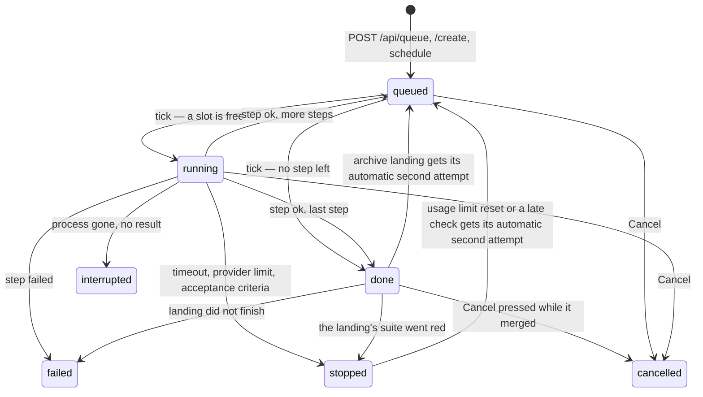

# A job's states

## Table of contents

- [The seven states](#the-seven-states)
- [The transitions](#the-transitions)
- [Execution group states](#execution-group-states)
- [Beside the state](#beside-the-state)
- [What the page makes of it](#what-the-page-makes-of-it)

---

A job carries a `state`, and only the queue's own state machine moves it. This page says what that state can be,
when it moves, and which fields beside it behave like a state without being one.

The states and transitions are `JOB_STATES` and `TRANSITIONS` in `src/queue/steps.ts`. Every write goes through
`QueueStore.transition()` in `src/queue/store/index.ts`.

Three pages sit beside this one:

- [The specs list and the spec page](the-specs-list.md) — how a state reads on the page
- [How a spec moves between phases](spec-transitions.md) — which of the four phases a SPEC has reached
- [Error sentences](error-sentences.md) — the rule a job's own `error` sentence follows

## The seven states

A job is an ordered list of steps with a `stepIndex`; its `state` says where the job as a whole is.

| State         | Meaning                                                                                                                                                                                                     |
|---------------|-------------------------------------------------------------------------------------------------------------------------------------------------------------------------------------------------------------|
| `queued`      | Waiting for the runner to start its next step. Also where a job sits between two steps.                                                                                                                     |
| `running`     | One step has a live process. `pid`, `pgid`, `resultFile`, `sessionId`, `stepStartedAt` and `streamFile` are set.                                                                                            |
| `done`        | No step is left to run. Written the instant the last step's process succeeds, so a landing that follows may still fail — and an `archive` held back on unticked criteria reaches it without running at all. |
| `stopped`     | A step reached its own time limit, a provider limit ended it, an analyze stopped on its acceptance criteria, or a landing's test run went red. `stopReason` says which.                                     |
| `failed`      | A step reported failure, or a landing after a successful step did not finish.                                                                                                                               |
| `cancelled`   | A user pressed Cancel.                                                                                                                                                                                      |
| `interrupted` | The step's process died without leaving a result.                                                                                                                                                           |

Only `queued` and `running` own their work (`UNFINISHED`), and the duplicate guard is built on that set alone. A
second guard refuses a NEW job of any step for a spec whose own job reads `done` with a landing still in flight; once
the landing settles, the same step may be queued again as a new job. A finished job is never resumed, except a step
its provider's usage limit stopped: the board queues it again as the same job (`limit-reset`).

## The transitions

**Into the queue.** A job is inserted as `queued` by a step button, Create, the schedule, Run now, the Close control
and the Deploy button on the board's own project page.

**The runner's tick**, every two seconds, takes the queued jobs in the order of `queuePriorityOrder()`: `create`,
`archive` and `close` first, since they do no model work, then `analyze` and `implement`, oldest first within each
group. For each queued job it uses this ordered list; the first hold that applies wins:

- Waits until an automatic retry is due.
- Leaves a job queued with a reason while its provider is switched off.
- Leaves a job queued with a reason while its provider's usage limit is still in force.
- Waits when every slot is in use. A board step and Create need no slot.
- Skips a job that has `landing` set: its next step waits for its own merge.
- Skips a job whose spec already has a running job.
- Leaves an `archive` queued, with the reason on it, while another `archive` in the same project is running or
  landing.
- Leaves a `schedule` job queued, with a reason, while anything else in its project is running or landing.
- Leaves a deploy queued, with a reason, while a landing is in flight.
- Leaves a job queued with "held back: not analyzed yet — run /aide-analyze first" until its spec's `analyze` has
  completed.
- Leaves an `implement` queued with "held back: choose the approach to build, then press Save" when its spec asked to
  choose the approach, has two or more real alternatives and none is chosen. An `implement` started on its own is
  never held for this. Saving another approach than the recommended one cancels it.
- Leaves a job queued with "held back: depends on …" until the dependency it names has archived.
- Ends an `archive` whose spec has an unticked acceptance row as `done`, without taking a slot, with
  `terminalReason: acceptance-criteria-unticked` and no cost. The row's badge reads **Ready**; the notice line under it
  carries the reason. A tick never starts the archive; a user presses Archive once the rows are ticked.
- Moves a job with no step left to `done`.
- Otherwise starts the step and writes `running`.

A held-back job keeps its state; the reason is on the row and clears on a later tick.

**When a step ends:**

- Every ending, including Cancel, clears `pid`, `pgid`, `sessionId` and `stepStartedAt`. It keeps `resultFile` for
  a landing that must resume after a restart and `streamFile` for the finished step's log; the next start replaces
  both.
- `timeout` or `provider-limit` gives `stopped`, with that `stopReason`. A `provider-limit` step also carries
  `providerLimit`: which window ran out, when it resets, the other windows' figures, and the plan or refused credit
  where the tool names them ([how the runner tells](the-runner.md#when-a-provider-limit-ends-a-step)). The row and
  the Logs tab say it in one sentence, in place of the runner's own summary. What a stopped step lands is in
  [landing.md](landing.md#branches-and-merging-them); a landing that does run leaves the job's `error` in place.
- A `provider-limit` stop also writes `usageLimitWait`: when the board queues the step again. It is the reset time
  the tool named when that is later than the stop, and an hour after the stop otherwise (`resetKnown` says which).
  The board starts no other queued step on that provider until then, and at that time `limit-reset` moves the job from
  `stopped` back to `queued` with no press. A stop recorded without a wait is never started again by the board.
- A step stopped on a usage limit can be run on another provider by choosing it in the phase's AI choice and pressing
  the step's button: that makes a new job on the chosen provider, which the stopped provider's wait does not hold.
- `model-at-capacity` gives `stopped`: the provider had no room for the model, so there is no reset to wait for. The
  job's `error` names the step's button and the model and says to press the button again or choose another model.
  It lands nothing, and the step is offered again. [How the runner tells](the-runner.md#when-a-provider-limit-ends-a-step).
- `shared-files` gives `stopped`: an analyze whose analysis names files another open spec also changes. The job's
  `error` names each spec with the files it shares.
- `acceptance-criteria` gives `stopped`: an analyze the runner stopped at the spec's `criteriaChecks: stop`. Its
  `error` names each fault the plan review found, by kind. The analysis stays on the spec's branch, where the next
  Analyze takes it up.
- Any other failure gives `failed`, with `error` and, when the runner found a merge conflict at step start,
  `errorReason: "conflict"`. A result whose `stop_reason` is `refusal` ends `model-refused`: the error names the step
  and says the model declined, and gives no advice about installing or logging in.
- Success on the last step gives `done`. Success with steps left gives `queued` again, with `stepIndex` advanced.
  There is no stop between steps: every step lands its own work.

**Interrupted** is written for a `running` job whose process is gone and whose result file is empty, while the server
runs ("the run vanished without leaving a result") and on boot ("the server restarted while this step was running").
A job whose process is gone but whose result is on disk is completed from that file.

**Cancelled** comes from `POST /api/queue/<id>/cancel` and from the test board's control, which cancels every queued
and running job of a project. Both write `cancelled` and then send `SIGTERM` to the job's process group. A job that
has already finished is refused with 409 and keeps its state.

**Done to failed** is the one transition made after the fact. The step succeeded and the job reads `done`; when the
landing is then refused for a conflict, or `archive`'s landing finds the spec's branch still on origin,
`landing-failed` moves it to `failed` with `errorReason`. It applies only from `done`: a job that has moved on keeps
its state, and only `landingError` (with `landingErrorDetail` beside it) records the attempt. The record names the
step it belongs to; that step's own landing clears it when it succeeds later, and a later step's success leaves it
alone. See [Branches and landing](landing.md).

**Done to stopped** is the landing failure that is nobody's fault. The landing runs the project's own suite on the
merged result, and a red suite pushes nothing: `landing-held` moves the job to `stopped` with
`stopReason: "tests-red"`, and the row carries an amber "tests red". The work is not green yet — run implement again.

Cancel works while a finished step's work is being merged and tested, though the job already reads `done`: nothing is
pushed, and `landing-cancelled` moves the job to `cancelled`.

## Execution group states

An execution group's state is separate from any one job. `prepared` has durable membership but has not been queued;
`queued` waits for a member job; `running` has started work; `stopped` keeps an error and can continue;
`waiting-acceptance` has finished member work but still has open acceptance criteria; `archiving` is attempting the
single group landing; and `completed` means that landing succeeded and the shared pull request, when required, was
opened. A failed Archive remains `archiving` or becomes `stopped`; it never becomes `completed` from a process result
alone.

---

## Beside the state

Three fields say something the state alone does not, and the page reads each as if it were one. `error` rides with
the last of them.

- **`landing`** is set on a job while its finished step's branch is merged. It holds back that job's own next step
  and nothing else on the board. It is not restored on a restart: the job is read back with `landingCut`, and the
  boot runs that landing again from the step's result file. Both an uninterrupted and a resumed landing stamp the
  step when the landing settles. The step's badge reads "Running", and its duration keeps counting until then. A
  chained job's next step reads "Queued", never "Running". A session writing an
  `onLanded` callback reads the caveat in [the landing rule](../.claude/rules/landing.md).

  A row also reads the spec's files and git history; how they are cached is in
  [the specs list](the-specs-list.md#the-page-changes-when-something-changes).
- **`stopReason`** is `timeout`, `provider-limit`, `model-at-capacity`, `tests-red`, `acceptance-criteria`, `shared-files` or `sent-back`, set with `stopped` and
  nowhere else. `stopped` is deliberately not `failed`: a time-stop is a common, healthy outcome, a red suite on a
  landing is work that is not green yet, and an analyze stopped on its acceptance criteria waits for the description
  to be put right. An implement sent back to a full analysis is stopped too: the board queues Analyze and Implement
  for the spec by itself.
- **`provider`** (`src/queue/types.ts`) is the provider each step runs on, as a key out of the config's `providers`,
  resolved when the job is made. A result carries `provider: { key, name }`: the provider the step ran on, under the
  name it had then.
- **`usageLimitWait`**, **`usageLimitProbe`** and **`pressed`**
  (`src/queue/types.ts`) belong to the usage-limit wait below. `usageLimitWait` is
  `{ until, resetKnown }` on a stopped job, cleared when the job is queued again. `usageLimitProbe` is
  `{ results, at, since }` on the one step sent ahead of the others. `pressed` is set on a job a person queued, and
  never on one the board queued by itself.
- **`errorReason`** is `conflict`, `held-back`, `tests-red` or `unlanded`, set when something stands in the way of
  the job: the class of it, for a reader who needs to act without matching on the sentence. `conflict` and `unlanded`
  are resolved by running `archive` again; `tests-red` by making the suite green and running the step again; and
  `held-back` clears itself on a later tick. A landing held for a red suite sets it beside `stopReason: tests-red`.
  It is declared in `src/queue/types.ts` and in `src/render/ui/job-state/types.ts`; a test asserts they agree.
  `error` is what a reader is told: always written on `failed`, on `interrupted`, on a `queued` job that is held
  back, and on a landing held for a red suite. A `timeout` or `provider-limit` stop passes the run's own error
  through. It is a `Sentence`, or several, translated where it is drawn.

**A usage limit's wait** (`src/queue/runner/usage-limit.ts`) is worked out from the queue on every tick, so a
restart of the board keeps it.

- A provider is held while one of its steps is stopped on `provider-limit` with a `usageLimitWait`, or while the step
  sent ahead of the others is running. Every `queued` job whose step runs on that provider waits with `held-back`;
  jobs on other providers start as before. A job whose own landing is in flight is not held, and neither is a deploy,
  which runs no AI.
- A hold belongs to one provider, by its key: a step on another provider of the same tool is held only by that
  provider's own wait.
- At the provider's time (the `until` of its newest stop, written onto every stopped step of that provider until then)
  `limit-reset` moves the stopped steps to `queued`, clearing `usageLimitWait`, `stopReason`, `finishedAt` and `error`.
  A step on that provider that started after a stop and ended `completed` does the same at once for every stop made
  before it; a step the board runs itself, such as a deploy, counts for nothing. A step that stops on the limit again gets a new
  wait, with no limit on how many times.
- With no reset time (`resetKnown: false`) only the oldest stopped step is queued again, as the probe; the others
  wait another hour. The provider stays held until the probe's step has ended. When it ends without a usage-limit stop,
  every step that stopped before it is queued again at once; when it stops on the limit, the provider waits for the new
  stop's time.
- A person's press queues a new job with `pressed`, which a stop made before it does not hold. A stopped step whose
  spec has had a job queued since the stop is not started again at its time.
- The step's transcript is `<job id>.<step>.stream.jsonl`; a later attempt of the same step is
  `<job id>.<step>.<n>.stream.jsonl`, so the stopped attempt's log stays.

**A deploy across its own restart.** The board's own deploy takes no slot, has no process group to signal, and a
cancel of a running one is refused (409). It writes `deploy.restartedAt`, restarts the server and is taken down with
it, so the job is `running` in the stored queue with an old pid and no result. The process that starts finishes it at
boot: `done` when it runs the fetched commit or one that contains it, `failed` otherwise or after three minutes. A
deploy found `running` without `deploy.restartedAt` was cut before its restart and is interrupted. While a landing is
in flight a queued deploy is held back, and a running one carries the same `held-back` reason (the one case of
`running` with an `errorReason`) until the wait ends.

## What the page makes of it

The row's badge is short by design, and what it does not say is on the notice line under it. A running job reads
**Running**; a queued one **Queued 3/11** — its place among every job waiting its turn — or "<phase> queued" when it
has no position, or **Held back**. Once nothing is running the badge is one word: **Ready**, **Done** or
**Stopped**, and `failed`, `cancelled` and `interrupted` are the bare word too.

The badge is that one word everywhere it appears: the row, the phase lines, the job page's chip and the schedule
report. Why a job stopped is on the row's message line and in the popover beside the job page's chip. `cancelled` is
drawn amber like `stopped`, since somebody stopped it by hand; `interrupted` is grouped with `failed`. The words live
in `src/render/ui/job-state/` and are described on [The specs list and the spec page](the-specs-list.md#the-state-column).
