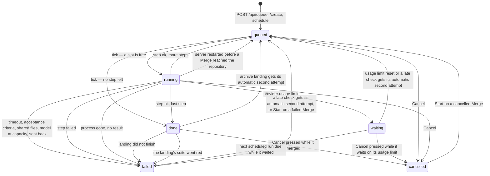

# A job's states

## Table of contents

- [The seven states](#the-seven-states)
- [The transitions](#the-transitions)
- [Execution group states](#execution-group-states)
- [Beside the state](#beside-the-state)
- [What the page makes of it](#what-the-page-makes-of-it)

---

A job carries a `state`, and only the queue's own state machine moves it. This page says what that state can be,
when it moves, and which fields beside it behave like a state without being one.

The states are `JOB_STATES` in `src/job-states.ts`; the transitions are `TRANSITIONS` in `src/queue/steps.ts`.
Every write goes through `QueueStore.transition()` in `src/queue/store/index.ts`.

Three pages sit beside this one:

- [The specs list and the spec page](the-specs-list.md) — how a state reads on the page
- [How a spec moves between phases](spec-transitions.md) — which of the four phases a SPEC has reached
- [Error sentences](error-sentences.md) — the rule a job's own `error` sentence follows

## The seven states

A job is an ordered list of steps with a `stepIndex`; its `state` says where the job as a whole is.

| State       | Meaning                                                                                                                                                                                                                                                                                                                |
| ----------- | ---------------------------------------------------------------------------------------------------------------------------------------------------------------------------------------------------------------------------------------------------------------------------------------------------------------------- |
| `queued`    | Waiting for the runner to start its next step. Also where a job sits between two steps.                                                                                                                                                                                                                                |
| `running`   | One step has a live process. `pid`, `pgid`, `resultFile`, `sessionId`, `stepStartedAt` and `streamFile` are set.                                                                                                                                                                                                       |
| `done`      | No step is left to run. Written the instant the last step's process succeeds, so a merge that follows may still fail — and an `archive` held back on unticked criteria reaches it without running at all.                                                                                                              |
| `waiting`   | A step a provider's usage limit ended. The board queues it again when the limit resets (`limit-reset`); nobody has to act.                                                                                                                                                                                             |
| `failed`    | The job did not finish and nobody stopped it: a step failed, its process died, it reached its time limit, an analyze stopped on its acceptance criteria or on shared files, a merge failed or its suite went red, or a scheduled job was still waiting for quota when its next run was due. `stopReason` names a stop. |
| `cancelled` | A person pressed Cancel.                                                                                                                                                                                                                                                                                               |

Only `queued` and `running` own their work (`UNFINISHED`), and the duplicate guard is built on that set alone. A
second guard refuses a NEW job of any step for a spec whose own job reads `done` with a merge still in flight; once
the merge settles, the same step may be queued again as a new job. A finished job is never resumed, except a step
waiting on its provider's usage limit: the board queues it again as the same job (`limit-reset`).

Only `failed` waits for a person. A failed or cancelled Merge is started again from its row as the same job, with its branch as it is on origin then (`restart`).

## The transitions

**Into the queue.** A job is inserted as `queued` by a step button, Create, the schedule, Run now, the Close control
and the Deploy button on the board's own project page.

**The runner's tick**, every two seconds, takes the queued jobs in the order of `queuePriorityOrder()`: `create`,
`archive` and `close` first, since they do no model work, then `analyze` and `implement`, oldest first within each
group. For each queued job it uses this ordered list; the first hold that applies wins:

- Waits until an automatic retry is due.
- Leaves a job queued with a reason while its provider is switched off.
- Leaves a job queued with a reason while its provider's usage limit is still in force.
- Waits when every slot is in use. A board step and Create need no slot.
- Skips a job that has `landing` set: its next step waits for its own merge.
- Skips a job whose spec already has a running job.
- Leaves an `archive` queued, with the reason on it, while another `archive` in the same project is running or
  merge.
- Leaves a `schedule` job queued, with a reason, while anything else in its project is running or merge.
- Leaves a deploy queued, with a reason, while a merge is in flight.
- Leaves a job queued with "held back: not analyzed yet — run Analyze first" until its spec's `analyze` has
  completed.
- Leaves an `implement` queued with "held back: choose the approach to build, then press Save" when its spec asked to
  choose the approach, has two or more real alternatives and none is chosen. An `implement` started on its own is
  never held for this. Saving another approach than the recommended one cancels it.
- Leaves a job queued with "held back: depends on …" until the dependency it names has archived.
- Ends an `archive` whose spec has an unticked acceptance row as `done`, without taking a slot, with
  `terminalReason: acceptance-criteria-unticked` and no cost. The row's badge reads **Ready**; the notice line under it
  carries the reason. A tick never starts the archive; a user presses Archive once the rows are ticked.
- Moves a job with no step left to `done`.
- Otherwise starts the step and writes `running`.

Before the process starts, the job stores the provider key resolved for the main step and each enabled side run.
The result, rows, logs and messages use those stored keys even if Settings changes while the step runs. Jobs written
before these keys were stored continue to resolve their provider from the current Settings.

A held-back job keeps its state; the reason is on the row and clears on a later tick.

**When a step ends:**

- Every ending, including Cancel, clears `pid`, `pgid`, `sessionId` and `stepStartedAt`. It keeps `resultFile` for
  a merge that must resume after a restart and `streamFile` for the finished step's log; the next start replaces
  both.
- `timeout` gives `failed` and `provider-limit` gives `waiting`, each with that `stopReason`. A `provider-limit` step also carries
  `providerLimit`: which window ran out, when it resets, the other windows' figures, and the plan or refused credit
  where the tool names them ([how the runner tells](the-runner.md#when-a-provider-limit-ends-a-step)). The row and
  the Logs tab say it in one sentence, in place of the runner's own summary. What such a step merges is in
  [merge.md](landing.md#branches-and-merging-them); a merge that does run leaves the job's `error` in place.
- A `provider-limit` stop also writes `usageLimitWait`: when the board queues the step again. It is the reset time
  the tool named when that is later than the stop, and an hour after the stop otherwise (`resetKnown` says which).
  The board starts no other queued step on that provider until then, and at that time `limit-reset` moves the job from
  `waiting` back to `queued` with no press.
- A step stopped on a usage limit can be run on another provider by choosing it in the phase's AI choice and pressing
  the step's button: that makes a new job on the chosen provider, which the waiting provider's wait does not hold.
  In an execution group, changing the provider resumes the same waiting job on its existing phases. The group's Stop
  cancels automatic restart; phase checkboxes are editable only after that Stop.
- `model-at-capacity` gives `failed`: the provider had no room for the model, so there is no reset to wait for. The
  job's `error` names the step's button and the model and says to press the button again or choose another model.
  It merges nothing, and the step is offered again. [How the runner tells](the-runner.md#when-a-provider-limit-ends-a-step).
- `shared-files` gives `failed`: an analyze whose analysis names files another open spec also changes. The job's
  `error` names each spec with the files it shares.
- `acceptance-criteria` gives `failed`: an analyze the runner stopped at the spec's `criteriaChecks: stop`. Its
  `error` names each fault the plan review found, by kind. The analysis stays on the spec's branch, where the next
  Analyze takes it up.
- Any other failure gives `failed`, with `error` and, when the runner found a merge conflict at step start,
  `errorReason: "conflict"`. A result whose `stop_reason` is `refusal` ends `model-refused`: the error names the step
  and says the model declined, and gives no advice about installing or logging in.
- Success on the last step gives `done`. Success with steps left gives `queued` again, with `stepIndex` advanced.
  There is no stop between steps: every step merges its own work.

**A job whose process died** is written `failed` when it was `running`, its process is gone and its result file is
empty, while the server runs ("the run vanished without leaving a result") and on boot ("the server restarted while this step was running").
A job whose process is gone but whose result is on disk is completed from that file.

**Cancelled** comes from `POST /api/queue/<id>/cancel` and from the test board's control, which cancels every queued
and running job of a project. Both write `cancelled` and then send `SIGTERM` to the job's process group. A job that
has already finished is refused with 409 and keeps its state, except a job waiting on its usage limit. Cancelling that
wait clears its automatic retry and probe metadata and signals no process; a scheduled job's wait uses
`cancel-schedule-wait`, every other job's `cancel`. A job cancelled while it was queued and before any
step started has no log, cost or result, and is removed from the queue instead of kept as `cancelled`, unless it is
a scheduled job. Scheduled jobs keep their cancelled records so the same scheduled occurrence is not queued again;
the next occurrence and a manual Run now are still allowed. The same retention rule applies when the queue loads.
Every cancel writes one line to the server's log naming the
job, the state it was in and what it was waiting for.

**The server's log** also gets one line for every action that went through (a `POST` that was not refused), naming
the route, the tailnet login, address and device it came from, and the job it acted on; the job keeps the same entry
in `actions`. A `POST` that only reads (`drift`, `test-command`) and a session's own report leave nothing. A job
held in the queue for more than five minutes gets a line naming the hold that keeps it, another when the hold
changes, and one when it starts.

**Done to failed** is the one transition made after the fact. The step succeeded and the job reads `done`; when the
merge is then refused for a conflict, or `archive`'s merge finds the spec's branch still on origin,
`landing-failed` moves it to `failed` with `errorReason`. It applies only from `done`: a job that has moved on keeps
its state, and only `landingError` (with `landingErrorDetail` beside it) records the attempt. The record names the
step it belongs to; that step's own merge clears it when it succeeds later, and a later step's success leaves it
alone. See [Branches and merging](landing.md).

**Done to failed for a red suite.** The merge runs the project's own suite on the merged result, and a red suite
pushes nothing: `landing-held` moves the job to `failed` with `stopReason: "tests-red"`. The work is not green yet —
run implement again.

Cancel works while a finished step's work is being merged and tested, though the job already reads `done`: nothing is
pushed, and `landing-cancelled` moves the job to `cancelled`.

## Execution group states

An execution group's state is separate from any one job. `prepared` has durable membership but has not been queued;
`queued` waits for a member job; `running` has started work; `stopped` keeps an error and can continue;
`waiting-acceptance` has finished member work but still has open acceptance criteria; `archiving` is attempting the
single group merge; and `completed` means that merge succeeded and the shared pull request, when required, was
opened. A failed Archive remains `archiving` or becomes `stopped`; it never becomes `completed` from a process result
alone. The group header follows this state through merging instead of inferring it from a member that has finished.
The shared Archive line keeps the actual stopped or failed reason and the retry action allowed by the same job rules.
The group's totals count the shared Archive attempt once.

---

## Beside the state

Three fields say something the state alone does not, and the page reads each as if it were one. `error` rides with
the last of them.

- **`landing`** is set on a job while its finished step's branch is merged. It holds back that job's own next step
  and nothing else on the board. It is not restored on a restart: the job is read back with `landingCut`, and the
  boot runs that merge again from the step's result file. Both an uninterrupted and a resumed merging stamp the
  step when the merge settles. The step's badge reads "Running", and its duration keeps counting until then. A
  chained job's next step reads "Queued", never "Running". A session writing an
  `onLanded` callback reads the caveat in [the merge rule](../.claude/rules/landing.md).

  A row also reads the spec's files and git history; how they are cached is in
  [the specs list](the-specs-list.md#the-page-changes-when-something-changes).
- **`stopReason`** is `timeout`, `provider-limit`, `model-at-capacity`, `tests-red`, `acceptance-criteria`, `shared-files` or `sent-back`, set with `failed`
  or, for `provider-limit`, `waiting`. It says why a run ended early, where the state says only that it did. An
  implement sent back to a full analysis is failed too, and the board queues Analyze and Implement for the spec by
  itself.
- **`provider`** (`src/queue/types.ts`) is the provider each step runs on, as a key out of the config's `providers`,
  resolved when the job is made. A result carries `provider: { key, name }`: the provider the step ran on, under the
  name it had then.
- **`usageLimitWait`**, **`usageLimitProbe`** and **`pressed`**
  (`src/queue/types.ts`) belong to the usage-limit wait below. `usageLimitWait` is
  `{ until, resetKnown }` on a waiting job, cleared when the job is queued again. `usageLimitProbe` is
  `{ results, at, since }` on the one step sent ahead of the others. `pressed` is set on a job a person queued, and
  never on one the board queued by itself.
- **`errorReason`** is `conflict`, `held-back`, `tests-red` or `unlanded`, set when something stands in the way of
  the job: the class of it, for a reader who needs to act without matching on the sentence. `conflict` and `unlanded`
  are resolved by running `archive` again; `tests-red` by making the suite green and running the step again; and
  `held-back` clears itself on a later tick. A merge held for a red suite sets it beside `stopReason: tests-red`.
  The values are defined once in `src/job-states.ts`. When the queue reads a stored job, it removes an
  `errorReason` outside this list and keeps the job, and reads the retired state `interrupted` as `failed`
  and the retired `stopped` as `waiting` for a usage-limit stop with a wait and `failed` otherwise.
  `error` is what a reader is told: always written on `failed`, on a `queued` job that is held
  back, and on a merge held for a red suite. A `timeout` or `provider-limit` stop passes the run's own error
  through. It is a `Sentence`, or several, translated where it is drawn.

**A usage limit's wait** (`src/queue/runner/usage-limit.ts`) is worked out from the queue on every tick, so a
restart of the board keeps it.

- A provider is held while one of its steps is `waiting` on `provider-limit` with a `usageLimitWait`, or while the step
  sent ahead of the others is running. Every `queued` job whose step runs on that provider waits with `held-back`;
  jobs on other providers start as before. A job whose own merge is in flight is not held, and neither is a deploy,
  which runs no AI.
- A hold belongs to one provider, by its key: a step on another provider of the same tool is held only by that
  provider's own wait.
- At the provider's time (the `until` of its newest stop, written onto every waiting step of that provider until then)
  `limit-reset` moves the waiting steps to `queued`, clearing `usageLimitWait`, `stopReason`, `finishedAt` and `error`.
  A step on that provider that started after a stop and ended `completed` does the same at once for every stop made
  before it; a step the board runs itself, such as a deploy, counts for nothing. A step that stops on the limit again gets a new
  wait, with no limit on how many times.
- With no reset time (`resetKnown: false`) only the oldest waiting step is queued again, as the probe; the others
  wait another hour. The provider stays held until the probe's step has ended. When it ends without a usage-limit stop,
  every step that started waiting before it is queued again at once; when it stops on the limit, the provider waits for the new
  stop's time.
- A person's press queues a new job with `pressed`, which a stop made before it does not hold. A waiting step whose
  spec has had a job queued since the stop is not started again at its time.
- The step's transcript is `<job id>.<step>.stream.jsonl`; a later attempt of the same step is
  `<job id>.<step>.<n>.stream.jsonl`, so the earlier attempt's log stays.

**A deploy across its own restart.** The board's own deploy takes no slot, has no process group to signal, and a
cancel while it fetches, installs or has committed its restart is refused (409). A running Deploy held back before
the restart can be cancelled; its wait then ends without firing the restart. It writes `deploy.restartedAt`, restarts the server and is taken down with
it, so the job is `running` in the stored queue with an old pid and no result. The process that starts finishes it at
boot: `done` when it runs the fetched commit or one that contains it, `failed` otherwise or after three minutes. A
deploy found `running` without `deploy.restartedAt` was cut before its restart and fails. While a merge is
in flight a queued deploy is held back, and a running one carries the same `held-back` reason (the one case of
`running` with an `errorReason`) until the wait ends.

## What the page makes of it

The row's badge is short by design, and what it does not say is on the notice line under it. A running job reads
**Running**; a queued one **Queued 3/11** — its place among every job waiting its turn — or "<phase> queued" when it
has no position. Blocked waiting work keeps its queue position and shows its reason on the notice line.

On Jobs, the card for an active spec whose job finished shows **Created**, **Analyzed** or **Implemented**.
If Archive is held back, the card shows **Held back** with the reason below it. **Done** on a spec card means its
workflow has ended through Archive or Close. The phase lines, job page and schedule report show the job's outcome.
Why a job stopped is on the row's message line and in the popover beside the job page's chip. `cancelled` is
drawn amber like `waiting`, since somebody stopped it by hand. The words live
in `src/render/ui/job-state/` and are described on [The specs list and the spec page](the-specs-list.md#the-state-column).
